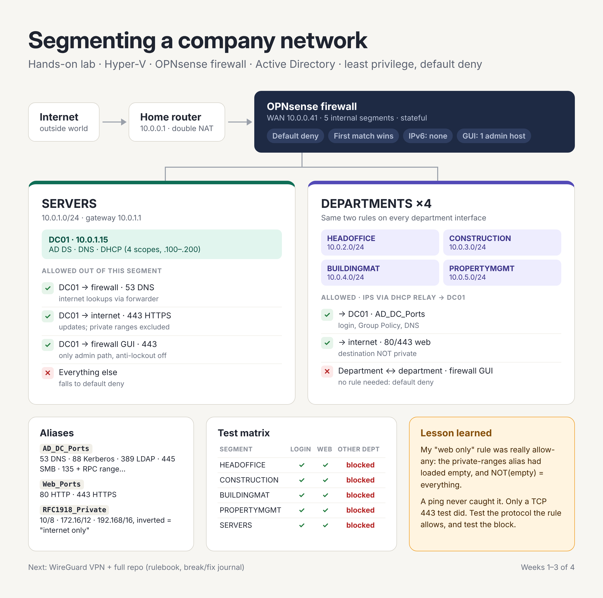

# DJGC network segmentation lab

A hands-on lab that segments a fictional company network (**DJ Group of Companies**) behind an OPNsense firewall on Hyper-V, with Active Directory, least-privilege rules, default deny, and a WireGuard VPN for remote admin. Every rule was **tested both ways**: what it should allow, and what it should block.

The goal wasn't the repo. It was to understand firewalls well enough to configure **any** firewall and its rules: interfaces, direction, source/destination, ports and protocols, rule order, state, aliases, and how to prove a rule works.

## What's here

| Doc | What it covers |
|---|---|
| [`docs/ip-plan.md`](docs/ip-plan.md) | Segments, subnets, gateways, DHCP relay, DNS, IPv6 decision |
| [`docs/baseline.md`](docs/baseline.md) | Platform, known-good state, recovery, accepted gaps |
| [`docs/firewall-rules.md`](docs/firewall-rules.md) | Every rule: what it allows, **why**, how it was **tested**, plus test matrices |
| [`docs/vpn-runbook.md`](docs/vpn-runbook.md) | WireGuard build, daily use, verification, troubleshooting by layer |
| [`docs/breakfix-journal.md`](docs/breakfix-journal.md) | 13 real problems hit while building it: symptom → cause → fix → lesson |

## Build summary

| Week | Stage | Outcome |
|---|---|---|
| 1 | Wiring | Hyper-V switches, OPNsense with 6 NICs (static MACs), WAN behind the home router |
| 2 | Addressing & services | Five /24 segments, DC01 (AD DS/DNS/DHCP), DHCP relay, AD Sites, domain login from departments |
| 3 | Policy | Default deny, least privilege per segment, admin GUI locked to one host, IPv6 closed |
| 4 | Remote access & proof | WireGuard VPN (RDP + DNS only), test matrices, docs |

## Lessons worth reading first
- **Break/fix #4:** a "web only" rule was really allow-any: an empty alias, inverted. A ping never caught it.
- **Break/fix #12:** green in the firewall log, but RDP failed. There were two firewalls in the path.
- **Break/fix #13:** a rule labeled DNS allowed every port. Labels are promises; ports are the truth.

## Stack
OPNsense 26.7 · Hyper-V · Windows Server (AD DS, DNS, DHCP) · WireGuard · PowerShell
